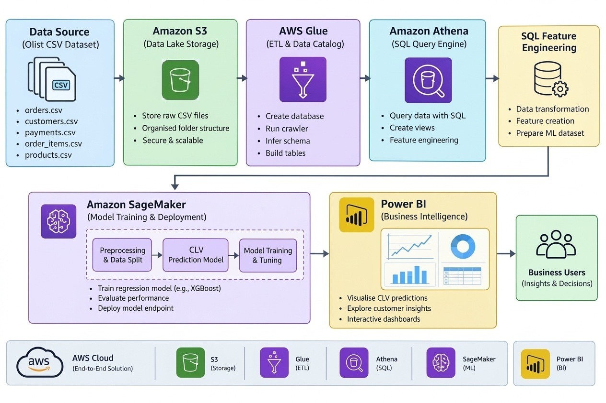

# Customer Lifetime Value (CLV) Prediction & Churn Risk Analysis on AWS

> End-to-End Customer Analytics, Machine Learning, and Business Intelligence Solution built on AWS using the Olist Brazilian E-Commerce Dataset.


---

# Table of Contents

- [Project Overview](#project-overview)
- [Business Problem](#business-problem)
- [Project Outcomes](#project-outcomes)
- [Technology Stack](#technology-stack)
- [Repository Structure](#repository-structure)
- [Dataset](#dataset)
- [AWS Environment](#aws-environment)
- [Data Lake Architecture](#data-lake-architecture)
- [Customer Analytics Framework](#customer-analytics-framework)
- [Customer Segmentation](#customer-segmentation)
- [Churn Analysis](#churn-analysis)
- [Churn Prediction Model](#churn-prediction-model)
- [Customer Lifetime Value Prediction](#customer-lifetime-value-prediction)
- [SQL Techniques Demonstrated](#sql-techniques-demonstrated)
- [Power BI Dashboard](#power-bi-dashboard)
- [Key Business Insights](#key-business-insights)
- [Challenges & Lessons Learned](#challenges--lessons-learned)
- [Future Improvements](#future-improvements)
- [Skills Demonstrated](#skills-demonstrated)

---

# Project Overview

This project demonstrates the design and implementation of an end-to-end cloud analytics and machine learning platform using AWS services and the Olist Brazilian E-Commerce Dataset.

The solution integrates Amazon S3, Amazon Athena, Amazon SageMaker, SQL, Python, and Power BI to perform:

- Customer analytics
- RFM segmentation
- Churn risk analysis
- Customer Lifetime Value (CLV) prediction
- Executive dashboard reporting

The project showcases practical skills in cloud data engineering, customer analytics, machine learning, and business intelligence while highlighting real-world challenges such as target leakage and limited predictive power in customer behavior models.

---

# Business Problem

E-commerce businesses need to answer several critical questions:

- Which customers generate the most value?
- Which customers are at risk of churning?
- How should retention budgets be allocated?
- Which customer groups deserve targeted campaigns?
- Can future customer value be estimated using historical purchasing behavior?

To answer these questions, an end-to-end analytics platform was built using AWS cloud services and customer transaction data.

---

# Project Outcomes

### Data Engineering

✅ Built a cloud-native analytics architecture on AWS

✅ Designed and implemented a data lake on Amazon S3

✅ Created Athena External Tables over raw CSV files

✅ Built reusable SQL feature engineering pipelines

✅ Exported machine learning datasets to S3

---

### Analytics

✅ Processed and analyzed **93,358 customers**

✅ Developed an RFM-based customer analytics framework

✅ Performed customer segmentation analysis

✅ Generated churn-risk indicators

✅ Built customer-level analytical datasets

---

### Machine Learning

✅ Built churn prediction workflows in SageMaker

✅ Built CLV prediction workflows in SageMaker

✅ Evaluated machine learning performance

✅ Identified and documented target leakage

✅ Demonstrated real-world model evaluation practices

---

### Business Intelligence

✅ Connected Athena directly to Power BI

✅ Developed executive dashboards

✅ Delivered customer segmentation insights

✅ Delivered churn and CLV reporting

---

# Architecture Diagram



---

# Technology Stack

| Layer | Technology |
|---------|------------|
| Cloud Platform | AWS |
| Data Lake | Amazon S3 |
| Analytics Engine | Amazon Athena |
| Machine Learning | Amazon SageMaker |
| Programming Language | Python |
| Query Language | SQL |
| Visualization | Power BI |
| Dataset | Olist Brazilian E-Commerce Dataset |

---

# Repository Structure

```text
customer-clv-churn-aws/
│
├── data/
│
├── sql/
│   ├── rfm.sql
│   ├── churn_features.sql
│   └── clv_features.sql
│
├── notebooks/
│   └── clv_model.ipynb
│
├── dashboard/
│   ├── AWS PowerBI project.pbix
│   └── dashboard_Screenshot
│
├── architecture/
│   └── block_diagram.png
│
└── README.md
```

---

# Dataset

## Olist Brazilian E-Commerce Dataset

The project uses the publicly available Olist Brazilian E-Commerce Dataset containing customer, order, payment, seller, and product information from a Brazilian online marketplace.

### Dataset Period

```text
2016-09-04 to 2018-10-17
```

### Primary Tables

| Table | Description |
|---------|-------------|
| olist_orders | Customer order transactions |
| olist_customers | Customer identifiers |
| olist_order_payments | Payment and revenue information |

### Key Columns

#### Orders

```text
order_id
customer_id
order_purchase_timestamp
```

#### Customers

```text
customer_id
customer_unique_id
```

#### Payments

```text
order_id
payment_value
```

**Note:** `customer_unique_id` is used as the customer identifier because `customer_id` changes across orders.

---

# AWS Environment

| Resource | Configuration |
|------------|------------|
| AWS Region | ap-southeast-2 (Sydney) |
| S3 Bucket | rimas-olist-clv-project2 |
| Athena Database | olist_db |
| SageMaker Notebook | olist-churn-analysis |
| BI Tool | Power BI |

---

# Data Lake Architecture

```text
s3://rimas-olist-clv-project2/

├── raw/
├── athena/
│
└── ml/
    ├── churn/
    │   └── current-snapshot/
    │
    ├── clv/
    │
    ├── predictions/
    │
    └── metrics/
```

Both raw and machine learning datasets are stored in Amazon S3, allowing Athena and Power BI to consume data from a centralized storage layer.

---

# Customer Analytics Framework

## RFM Analysis

Customer behavior was analyzed using the RFM Framework.

### Recency

Days since the customer’s last purchase.

### Frequency

Total number of purchases made by a customer.

### Monetary

Total revenue generated by a customer.

---

## Why RFM?

RFM analysis is widely used because it provides a simple and interpretable method for identifying customer value and purchasing behavior.

Common business applications include:

- Customer segmentation
- Retention campaigns
- Loyalty programs
- Revenue optimization
- Marketing personalization

---

# Customer Segmentation

Customers were segmented using Monetary value.

## Segment Rules

| Segment | Rule |
|----------|----------|
| High Value | Monetary ≥ 500 |
| Medium Value | Monetary ≥ 200 |
| Low Value | Monetary < 200 |

---

## Segmentation Results

| Segment | Customers | Share |
|----------|------------:|------------:|
| Low Value | 73,371 | 78.6% |
| Medium Value | 15,722 | 16.8% |
| High Value | 4,265 | 4.6% |

### Business Interpretation

The customer base is heavily concentrated in the Low Value segment.

Only 4.6% of customers belong to the High Value segment, making them the most valuable audience for retention and loyalty initiatives.

This finding reflects a common business pattern where a small proportion of customers often contributes a disproportionately large share of value.

---

# Churn Analysis

## Churn Definition

A customer is classified as churned when:

```text
Recency > 180 days
```

---

## Churn Distribution

| Customer Status | Customers |
|-----------------|-----------:|
| Active | 37,559 |
| Churned | 55,799 |

---

## Customer Behavior Comparison

| Metric | Active | Churned |
|----------|----------:|----------:|
| Average Recency | 93.40 | 339.48 |
| Average Frequency | 1.04 | 1.03 |
| Average Monetary | 169.49 | 162.31 |

### Key Finding

Recency emerged as the strongest churn indicator.

Customers who had not purchased recently were much more likely to be classified as churned, while Frequency and Monetary metrics showed relatively little separation between active and churned groups.

---

# Churn Prediction Model

### Model

```text
Logistic Regression
```

### Platform

```text
Amazon SageMaker
```

### Features

```text
recency
frequency
monetary
avg_order_value
```

### Target

```text
churned
```

---

## Important Disclaimer

⚠️ These results should not be interpreted as production-quality performance.

The churn label was derived directly from Recency, while Recency was also included as a model feature. This introduced target leakage and artificially inflated performance metrics.

The churn model is included primarily to demonstrate the AWS machine learning workflow.

---

## Model Performance

| Metric | Value |
|----------|-------:|
| Accuracy | 1.00 |
| Precision | 1.00 |
| Recall | 1.00 |
| F1 Score | 1.00 |
| ROC-AUC | 1.00 |

---

## Feature Importance

| Feature | Coefficient |
|----------|------------:|
| Recency | 6.624 |
| Avg Order Value | 0.0019 |
| Monetary | -0.0020 |
| Frequency | -0.0489 |

---

# Customer Lifetime Value Prediction

A second workflow was developed to estimate future customer spending.

---

## Feature Window

```text
Before 2018-03-01
```

### Features

```text
recency
frequency
monetary
avg_order_value
```

---

## Prediction Window

```text
2018-03-01 to 2018-09-01
```

### Target

```text
future_spend
```

---

# CLV Prediction Model

### Model

```text
Linear Regression
```

### Platform

```text
Amazon SageMaker
```

---

## Model Performance

| Metric | Value |
|----------|----------:|
| MAE | 3.558 |
| RMSE | 19.siness insight.

Possible causes include:

- High concentration of one-time buyers
- Limited repeat purchasing behavior
- Lack of behavioral features
- Short customer purchase histories

This demonstrates an important lesson in data science:

> Not every business problem is highly predictable using simple historical features.

---

# SQL Techniques Demonstrated

This project demonstrates several important SQL techniques in Amazon Athena:

- Common Table Expressions (CTEs)
- Multi-table joins
- Aggregations
- Date functions
- Customer feature engineering
- Athena view creation
- RFM analytics
- Customer segmentation logic
- Churn label generation

---

# Power BI Dashboard

Power BI connects directly to Athena via ODBC.

## Data Sources

```text
customer_analytics
clv_model_metrics
```

---

## Dashboard Pages

### Executive Summary

- Total Revenue
- Total Customers
- Average Order Value
- Churn Rate

### Customer Segmentation

- Segment Distribution
- Revenue by Segment
- Segment Performance

### Churn Analysis

- Churn Distribution
- Recency by Churn Status
- Churn Drivers

### CLV Prediction

- Actual vs Predicted Spend
- Prediction Error Analysis
- CLV Distribution

---

# Dashboard Preview

## CLV Dashboard

dashboard/dashboard_Screenshot.png

---

# Key Business Insights

### Customer Value Concentration

Approximately 79% of customers belong to the Low Value segment, while only 4.6% belong to the High Value segment.

### Customer Retention

Customer inactivity is the strongest indicator of churn behavior.

### Customer Lifetime Value

Historical transaction data alone is insufficient to accurately forecast future customer spending.

### Business Strategy

Organizations should prioritize retention of High Value customers while enriching customer datasets with additional behavioral variables to improve CLV modeling.

---

# Challenges & Lessons Learned

- Identified and documented target leakage in churn prediction.
- Applied time-based validation for CLV forecasting.
- Learned the importance of honest model evaluation.
- Built an end-to-end AWS analytics architecture.
- Connected cloud analytics outputs directly to business intelligence reporting.

---

# Future Improvements

Potential enhancements include:

- XGBoost CLV models
- LightGBM regression
- Probabilistic CLV modeling (BG/NBD + Gamma-Gamma)
- Review sentiment analysis
- Product category features
- Geographic customer features
- K-Means segmentation
- AWS Glue ETL pipelines
- Step Functions orchestration
- Automated MLOps workflows

---

# Skills Demonstrated

### AWS

- Amazon S3
- Amazon Athena
- Amazon SageMaker
- IAM
- Data Lake Architecture

### SQL & Analytics

- Customer Analytics
- SQL Feature Engineering
- Customer Segmentation
- RFM Analysis
- Churn Analytics

### Machine Learning

- Logistic Regression
- Linear Regression
- Model Evaluation
- Target Leakage Detection
- Feature Importance Analysis

### Business Intelligence

- Power BI
- Dashboard Design
- KPI Development
- Executive Reporting

---

# Author

**Rimas**

Data Analytics | Business Intelligence | AWS Analytics | Machine Learning

GitHub: https://github.com/Rimas-Codes

Dataset: https://www.kaggle.com/datasets/olistbr/brazilian-ecommerce
