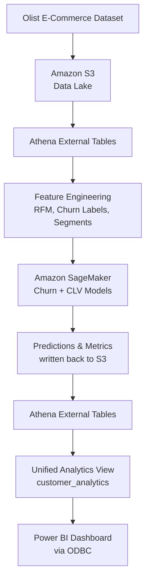

# Customer Lifetime Value Prediction & Churn Risk Analysis on AWS

An end-to-end cloud analytics and machine learning project built on AWS using the **Olist Brazilian E-Commerce dataset**. The solution covers a data lake on Amazon S3, SQL feature engineering in Amazon Athena, churn and CLV modelling in Amazon SageMaker, and an executive dashboard in Power BI.


-blue)


---

## Table of Contents

1. [Project Overview](#project-overview)
2. [Business Problem](#business-problem)
3. [Architecture](#architecture)
4. [Tech Stack](#tech-stack)
5. [Dataset](#dataset)
6. [AWS Environment](#aws-environment)
7. [Data Lake Structure](#data-lake-structure)
8. [Implementation Walkthrough](#implementation-walkthrough)
9. [Customer Segmentation Results](#customer-segmentation-results)
10. [Churn Analysis & Model](#churn-analysis--model)
11. [CLV Prediction Model](#clv-prediction-model)
12. [Power BI Dashboard](#power-bi-dashboard)
13. [Key Business Insights](#key-business-insights)
14. [Challenges & Lessons Learned](#challenges--lessons-learned)
15. [Limitations & Next Steps](#limitations--next-steps)
16. [Repository Structure](#repository-structure)
17. [Author](#author)

---

## Project Overview

This project demonstrates a full customer analytics workflow in the cloud:

1. Ingest raw e-commerce data into an **S3 data lake**.
2. Query it in place with **Athena external tables**.
3. Engineer **RFM features**, churn labels and customer segments with SQL.
4. Train **churn** and **CLV** models in **SageMaker**.
5. Write predictions and metrics back to S3 and expose them through Athena.
6. Deliver insights through a **Power BI** dashboard connected to Athena via ODBC.

The aim is a portfolio-quality solution that spans **AWS data engineering, AWS machine learning, SQL, Power BI and customer analytics**.

---

## Business Problem

E-commerce companies need to answer questions such as:

- Which customers are most valuable?
- Which customers are likely to stop purchasing?
- How should marketing resources be allocated?
- Which customers should be targeted for retention campaigns?

The Olist dataset provides transaction-level information that makes it possible to build a customer analytics framework to address these questions.

---

## Architecture



> You can also place an exported architecture diagram at `architecture/aws_architecture.png` and reference it here.

---

## Tech Stack

| Layer | Technology |
|---|---|
| Storage / Data Lake | Amazon S3 |
| Query & Feature Engineering | Amazon Athena (SQL) |
| Machine Learning | Amazon SageMaker Notebook, Python (Logistic Regression, Linear Regression) |
| Business Intelligence | Power BI Desktop (Athena ODBC connection) |
| Documentation | GitHub / Markdown |

---

## Dataset

**Olist Brazilian E-Commerce Dataset**

- Period covered: **2016-09-04 to 2018-10-17**
- Tables used in the analysis:

| Table | Key columns |
|---|---|
| `olist_orders` | `order_id`, `customer_id`, `order_purchase_timestamp` |
| `olist_customers` | `customer_id`, `customer_unique_id` |
| `olist_order_payments` | `order_id`, `payment_value` |

`customer_unique_id` is used as the customer identifier, since `customer_id` is generated per order.

---

## AWS Environment

| Setting | Value |
|---|---|
| Region | `ap-southeast-2` (Sydney) |
| S3 bucket | `rimas-olist-clv-project2` |
| Athena database | `olist_db` |
| SageMaker notebook | `olist-churn-analysis` |
| Power BI connection | Athena via ODBC |

---

## Data Lake Structure

```text
s3://rimas-olist-clv-project2/
├── raw/
├── athena/                      # Athena query results
└── ml/
    ├── churn/
    │   └── current-snapshot/
    │       └── olist_customer_features_current_snapshot.csv
    ├── clv/
    │   └── olist_clv_training_dataset.csv
    ├── predictions/
    │   └── clv_predictions.csv
    └── metrics/
        └── clv_model_metrics.csv
```

Bucket settings: general purpose bucket, ACLs disabled, all public access blocked, SSE-S3 encryption.

---

## Implementation Walkthrough

### 1. S3 data lake
Raw Olist CSV files are uploaded to S3 and organised into prefixes (e.g. `orders/`, `customers/`, `payments/`) so each Athena table points at its own folder. Athena query results are written to a dedicated results location.

### 2. Athena external tables
Tables are defined over the CSV files using the OpenCSV SerDe, with the header row skipped.

```sql
CREATE DATABASE olist_db;

CREATE EXTERNAL TABLE olist_orders (
  order_id STRING,
  customer_id STRING,
  order_status STRING,
  order_purchase_timestamp STRING,
  order_approved_at STRING,
  order_delivered_carrier_date STRING,
  order_delivered_customer_date STRING,
  order_estimated_delivery_date STRING
)
ROW FORMAT SERDE 'org.apache.hadoop.hive.serde2.OpenCSVSerde'
WITH SERDEPROPERTIES ("separatorChar" = ",", "quoteChar" = "\"")
STORED AS TEXTFILE
LOCATION 's3://rimas-olist-clv-project2/orders/'
TBLPROPERTIES ("skip.header.line.count" = "1");
```

`olist_customers` and `olist_order_payments` are created the same way.

### 3. RFM base view
Delivered orders are joined to payments and customers to compute order value per customer.

```sql
CREATE VIEW olist_rfm_base AS
SELECT
  o.order_id,
  c.customer_unique_id,
  o.order_purchase_timestamp,
  SUM(p.payment_value) AS total_order_value
FROM olist_orders o
LEFT JOIN olist_order_payments p ON o.order_id = p.order_id
LEFT JOIN olist_customers c      ON o.customer_id = c.customer_id
WHERE o.order_status = 'delivered'
GROUP BY o.order_id, c.customer_unique_id, o.order_purchase_timestamp;
```

### 4. RFM calculation
Recency is measured against a fixed analysis date of `2018-09-01`.

```sql
CREATE VIEW olist_rfm_calc AS
WITH customer_rfm AS (
  SELECT
    customer_unique_id,
    DATE '2018-09-01' AS analysis_date,
    CAST(MAX(date_parse(order_purchase_timestamp, '%Y-%m-%d %H:%i:%s')) AS DATE) AS last_order_date,
    COUNT(DISTINCT order_id) AS frequency,
    SUM(total_order_value)   AS monetary
  FROM olist_rfm_base
  GROUP BY customer_unique_id
)
SELECT
  customer_unique_id, analysis_date, last_order_date,
  date_diff('day', last_order_date, analysis_date) AS recency,
  frequency, monetary
FROM customer_rfm;
```

### 5. Churn label, features and segments
A customer is flagged as churned if inactive for **more than 180 days**.

```sql
CREATE VIEW olist_customer_features AS
SELECT
  customer_unique_id, recency, frequency, monetary,
  monetary / NULLIF(frequency, 0) AS avg_order_value,
  CASE WHEN recency > 180 THEN 1 ELSE 0 END AS churned
FROM olist_rfm_calc;

CREATE VIEW olist_customer_segments AS
SELECT *,
  CASE
    WHEN monetary >= 500 THEN 'High Value'
    WHEN monetary >= 200 THEN 'Medium Value'
    ELSE 'Low Value'
  END AS customer_segment
FROM olist_customer_features;
```

### 6. ML dataset export
The segmented customer dataset (93,358 customers) is exported and saved to S3 as `olist_customer_features_current_snapshot.csv`, then used as input to SageMaker.

### 7. Modelling in SageMaker
Two models were trained in a SageMaker notebook (`ml.t3.medium`): a churn classifier and a CLV regressor. Predictions and metrics were written back to S3 and exposed through Athena external tables.

### 8. Unified analytics view
The `customer_analytics` Athena view combines the engineered features, segments, churn flag and model predictions:

`customer_unique_id`, `recency`, `frequency`, `monetary`, `avg_order_value`, `churned`, `customer_segment`, `predicted_clv`

---

## Customer Segmentation Results

Segments are based on total customer spend (`monetary`).

| Segment | Rule | Customers | Share |
|---|---|---:|---:|
| Low Value | < 200 | 73,371 | 78.6% |
| Medium Value | 200 – 499 | 15,722 | 16.8% |
| High Value | ≥ 500 | 4,265 | 4.6% |
| **Total** | | **93,358** | |

---

## Churn Analysis & Model

### Churn distribution (churn = inactive > 180 days)

| Status | Customers |
|---|---:|
| Active | 37,559 |
| Churned | 55,799 |

### Behaviour by churn status

| Metric | Active | Churned |
|---|---:|---:|
| Avg Recency (days) | 93.40 | 339.48 |
| Avg Frequency | 1.04 | 1.03 |
| Avg Monetary | 169.49 | 162.31 |

**Recency is the dominant differentiator.** Frequency and spend are almost identical between active and churned customers.

### Churn prediction model

- **Platform:** Amazon SageMaker
- **Model:** Logistic Regression
- **Features:** `recency`, `frequency`, `monetary`, `avg_order_value`
- **Target:** `churned`

| Metric | Score |
|---|---:|
| Accuracy | 1.00 |
| Precision | 1.00 |
| Recall | 1.00 |
| F1 Score | 1.00 |
| ROC-AUC | 1.00 |

| Feature | Coefficient |
|---|---:|
| Recency | 6.624 |
| Avg Order Value | 0.0019 |
| Monetary | -0.0020 |
| Frequency | -0.0489 |

> ### ⚠️ Target leakage
> The churn label was derived directly from `recency` (`recency > 180`), and `recency` was also used as a model feature. The perfect scores therefore reflect leakage, not genuine predictive ability. This model is included **as proof of the AWS machine learning pipeline** and should **not** be treated as a production-ready churn solution.

---

## CLV Prediction Model

A second workflow predicts future customer spend using a time-based split to avoid leakage.

| Window | Dates |
|---|---|
| Feature window | Before 2018-03-01 |
| Prediction window | 2018-03-01 to 2018-09-01 |

- **Features:** `recency`, `frequency`, `monetary`, `avg_order_value`
- **Target:** `future_spend`
- **Model:** Linear Regression (Amazon SageMaker)
- **Training dataset:** `s3://rimas-olist-clv-project2/ml/clv/olist_clv_training_dataset.csv`

### Results

| Metric | Value |
|---|---:|
| MAE | 3.558 |
| RMSE | 19.839 |
| R² | 0.000154 |

Customers with CLV predictions in `customer_analytics`: **55,544** (of 93,358).

### Interpretation

With R² ≈ 0, simple RFM features have very little predictive power for future spend in this dataset. This is an honest, realistic outcome. Likely contributing factors:

- A large share of one-time customers
- Limited repeat purchasing
- No behavioural features (e.g. browsing, product category, reviews, delivery experience)
- Short customer history

Model outputs:

- Predictions: `s3://rimas-olist-clv-project2/ml/predictions/clv_predictions.csv`
- Metrics: `s3://rimas-olist-clv-project2/ml/metrics/clv_model_metrics.csv`

---

## Power BI Dashboard

The dashboard connects to Athena via ODBC and loads two tables: `customer_analytics` and `clv_model_metrics`.

| Page | Contents |
|---|---|
| **Executive Summary** | Total Revenue, Total Customers, Average Order Value, Churn Rate |
| **Customer Segmentation** | Segment distribution, revenue by segment, segment performance |
| **Churn Analysis** | Churn distribution, recency by churn status, churn drivers |
| **CLV Prediction** | Actual vs predicted spend, prediction error analysis, CLV distribution |

<!-- Add screenshots, e.g.:


-->

---

## Key Business Insights

- **Recency is the strongest indicator of churn.** Churned customers average ~339 days since last purchase vs ~93 for active customers.
- **Most customers buy once.** Average frequency is ~1.0 for both active and churned customers, so retention and repeat-purchase strategies are the main growth lever.
- **Value is concentrated.** Only ~4.6% of customers are High Value, while ~79% are Low Value. The High Value group is the natural target for retention campaigns.
- **Simple RFM is not enough to forecast future spend.** Richer behavioural features are needed for a useful CLV model.

---

## Challenges & Lessons Learned

- **Target leakage detection.** A perfect churn model was a red flag. Feature importance analysis showed that recency dominated because the label was built from it.
- **Honest reporting of weak models.** A near-zero R² is a legitimate finding, and it was documented rather than hidden.
- **Time-based validation.** Separating the feature window from the prediction window is essential for CLV problems.
- **Cloud setup.** New AWS accounts can hit SageMaker resource limits; local Python / Jupyter / VS Code is a viable fallback.

**Skills practised:** S3 data lake design, Athena external tables, SQL feature engineering, RFM analysis, customer segmentation, churn analysis, model evaluation, leakage detection, Power BI KPI design and executive reporting.

---

## Limitations & Next Steps

**Limitations**

- The churn model suffers from target leakage and is illustrative only.
- The CLV model has near-zero predictive power with RFM features alone.
- Customer segments use fixed spend thresholds rather than data-driven clustering.

**Possible improvements**

- Define churn on a future window (e.g. no purchase in the next N days) using only past behaviour.
- Add features: product category, review scores, delivery delays, payment type, geography.
- Try probabilistic CLV models (BG/NBD + Gamma-Gamma) and tree-based models (XGBoost / LightGBM).
- Use data-driven segmentation (quantile-based RFM scoring or K-Means).
- Convert CSV outputs to Parquet and partition for lower Athena cost.
- Automate the pipeline (Glue / Step Functions) and add data-quality checks.

---

## Repository Structure

```text
customer-clv-churn-aws/
├── README.md
├── architecture/
│   └── aws_architecture.png
├── sql/
│   ├── 01_create_tables.sql
│   ├── 02_rfm_views.sql
│   ├── 03_churn_and_segments.sql
│   └── 04_customer_analytics_view.sql
├── notebooks/
│   ├── churn_model.ipynb
│   └── clv_model.ipynb
├── dashboard/
│   ├── customer_analytics.pbix
│   └── screenshots/
└── results/
    └── clv_model_metrics.csv
```

---

## Author

**Rimas**
GitHub: [@Rimas-Codes](https://github.com/Rimas-Codes)

*Dataset: [Olist Brazilian E-Commerce Public Dataset](https://www.kaggle.com/datasets/olistbr/brazilian-ecommerce) (Kaggle).*
